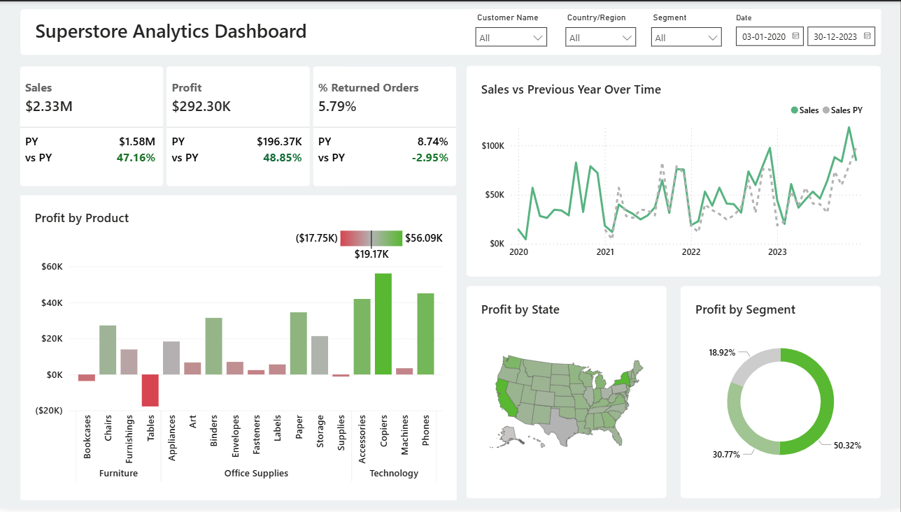

# Superstore Analytics Dashboard — Power BI Practice Project

An independent Power BI practice project using the included Sample Superstore workbook. The repository contains a PBIX report, the workbook, and one dashboard screenshot. This is not a client engagement.

## Repository files

- [Power BI report](Superstore%20Analytics%20Dashboard.pbix)
- [Sample Superstore workbook](Sample%20-%20Superstore.xls)
- [Dashboard overview image](outputsdashboard_overview.png)

## Dashboard preview

The report is intended for exploring sales and profit in the sample workbook. Any observations should be treated as descriptive findings about this dataset, not as evidence of business impact.

## Open the report

1. Download the PBIX and workbook from this repository.
2. Open the PBIX in Power BI Desktop.
3. If Power BI asks for the workbook location, select the downloaded `Sample - Superstore.xls` file or update the source path in Power Query.

## Data and reproducibility notes

The workbook is included, but the repository does not identify its original publisher, version, or reuse terms. It also does not include a data dictionary or transformation log, and dashboard KPIs have not been independently reconciled. Treat the report as a practice analysis until those details are documented and checked.
